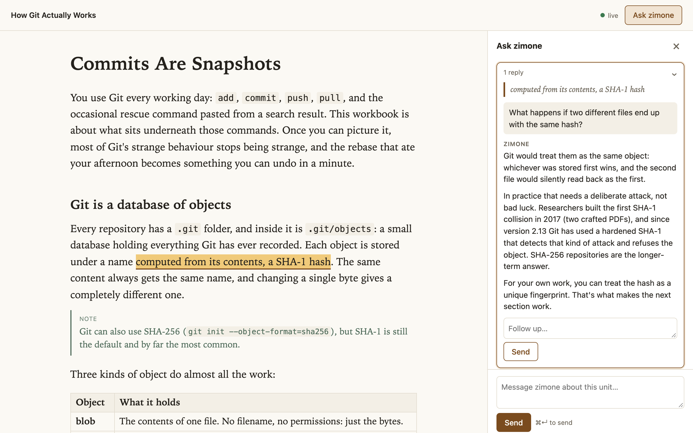
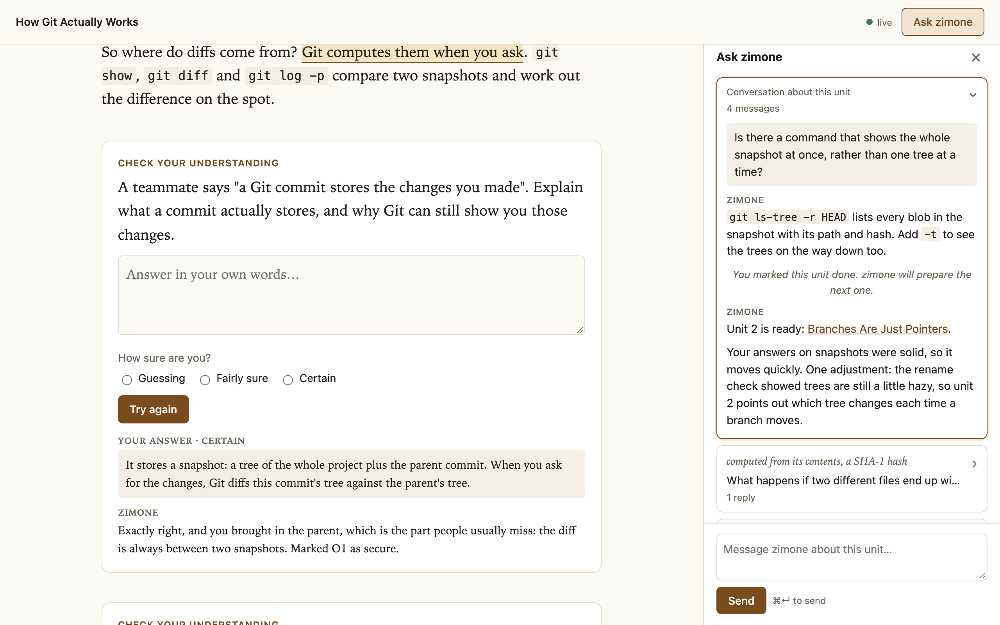
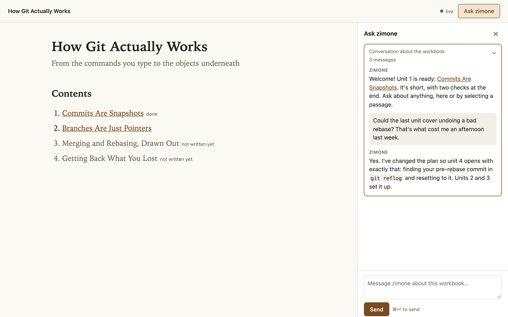

# zimone

Workbooks you can talk to. Claude interviews you about what you want to learn, plans a course,
and writes it as a workbook: a folder of units you work through in the browser. You can talk to
zimone from a sidebar on every page, about the workbook, the unit, or a passage you've selected.
You can also answer retrieval checks and mark units done. All of that comes back to the
Claude Code session that's teaching you. It answers on the page, adds margin notes, keeps a
model of what you know, and adapts the units you haven't reached yet.

This repository is the tool: a Claude Code plugin. Your workbooks live wherever you choose.



## Install

In Claude Code (2.1.275 or later):

```
/plugin install zimone --marketplace JuneKelly/zimone
```

Or from a shell:

```bash
claude plugin marketplace add JuneKelly/zimone
```

```bash
claude plugin install zimone@zimone-marketplace
```

Requires Node 20 or later. There is nothing else to install: the one library zimone uses, the
markdown-it parser, is vendored in `plugins/zimone/runtime/vendor/`.

## Use

**Start a workbook where you are.** In an empty folder, a workbook folder, or any project:

```
/zimone:new relational databases
```

What happens depends on the folder:

- **Empty folder**: zimone interviews you (goal, a few diagnostic questions, scope and style),
  proposes a syllabus for your approval, writes unit one, and opens the workbook in your browser.
  The folder *is* the workbook, and this session is its tutor.
- **Another project**: say you're deep in an app and realise you need to understand query
  planning. zimone runs a short interview seeded from the conversation. It asks where your workbook
  library lives (once) and which bits of the project to copy in as context. Then it writes a
  `brief.md` into a new workbook folder and hands off to a session started there. Your working
  session stays on your work.

**Open a workbook**, whether it's one you commissioned or one you're coming back to. Start a
session in its folder and run:

```
/zimone:open
```

For a commissioned workbook, the first `/zimone:open` settles what the brief left open, proposes
the syllabus, and writes unit one. After that, it picks up where you left off.

## Working through a workbook

Select any passage and choose **Ask about this**, or message zimone about the unit or the
whole workbook from the sidebar. Each unit ends with retrieval checks: you answer in your own
words, say how sure you are, and zimone replies with feedback. When you mark a unit done,
zimone writes the next one, adjusted for what your questions and answers showed.

A workbook can show other words for its parts. Set `terms` in `workbook.json` and the page says,
say, "book" and "chapter" instead of "workbook" and "unit".



The contents page shows which units are done, ready, or not written yet. Its sidebar is
a conversation about the workbook as a whole, for things like changing the plan.



## What a workbook looks like

```
my-workbook/
  workbook.json    zimone_format, title, optional display terms, ordered unit list
  plan.md          aim, objectives O1…, syllabus, amendments log
  learner.md       motivation, goals, starting point, objective evidence, inquiry log
  brief.md         if commissioned from another session
  context/         copied material the workbook draws on
  units/*.md       units (Markdown, every block carries a stable {#id})
  .zimone/         server state: threads, event queue and progress (git-ignored)
```

A workbook is plain files, so put it under git if you'd like a history of how it was revised.
`examples/demo` is a small sample: the first two units of "How Git Actually Works", the
workbook in the screenshots.

## How it works

```
browser ──HTTP/SSE──▶ zimone server ◀──claim── zimone watch ─stdout─▶ Monitor ──▶ Claude session
   ▲                       │  ▲                                                        │
   └── SSE: replies, ──────┘  └──────────── zimone reply / ack (HTTP) ◀────────────────┤
       reloads                                                                          │
   ▲                                                                                    │
   └─────────── fs.watch on units/*.md ◀──── session edits unit files ◀─────────────────┘
```

| Path | What it is |
|---|---|
| `plugins/zimone/skills/new`, `skills/open` | The two skills |
| `plugins/zimone/reference/` | Shared agent instructions: workbook format and authoring, serving and event handling |
| `plugins/zimone/runtime/bin/zimone.mjs` | CLI: `docs`, `library`, `detect`, `serve`, `url`, `watch`, `reply`, `post`, `ack`, `thread`, `check`. The skills pre-approve it, and route reference docs and plugin settings through it, so they don't trigger file-permission prompts |
| `plugins/zimone/runtime/lib/` | Unit renderer and validator (block ids, directives), workbook loader, HTTP server |
| `plugins/zimone/runtime/vendor/markdown-it/` | Vendored Markdown parser, unmodified; `SOURCE.md` records its version and checksum |
| `plugins/zimone/runtime/shell/` | The page you work in |
| `.claude-plugin/marketplace.json` | Makes this repo its own one-plugin marketplace |

The server binds to 127.0.0.1. It takes the first free port from 4317, so several workbooks can
be open at once. It rejects foreign Host and Origin headers and non-JSON POSTs, so other
websites can't inject events into your session.

User events reach the session through a Monitor running `zimone watch`. A Monitor has to be
re-armed every 30 minutes; events still unhandled at that point are delivered again.
Claude Code [channels](https://code.claude.com/docs/en/channels) would remove the re-arming,
but they are flag-gated during their research preview. Only `zimone watch` would need to change.

## Develop

Load the plugin from this checkout for one session:

```bash
claude --plugin-dir ./plugins/zimone
```

Or register the checkout as a local marketplace, so every session picks up your edits (run
`/reload-plugins` to apply them mid-session):

```bash
claude plugin marketplace add ./
```

```bash
claude plugin install zimone@zimone-marketplace
```

Validate after changes:

```bash
claude plugin validate .
```

Try the page without an agent:

```bash
node plugins/zimone/runtime/bin/zimone.mjs serve examples/demo
```

## License

MIT; see [LICENSE](LICENSE). The vendored markdown-it is also MIT, under its own
[licence](plugins/zimone/runtime/vendor/markdown-it/LICENSE).
